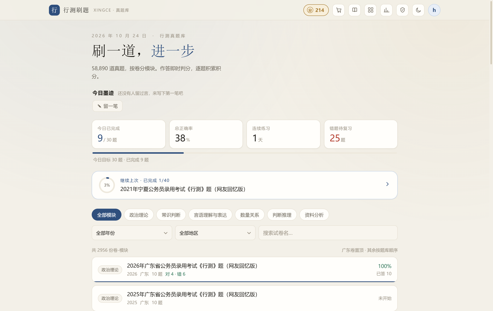
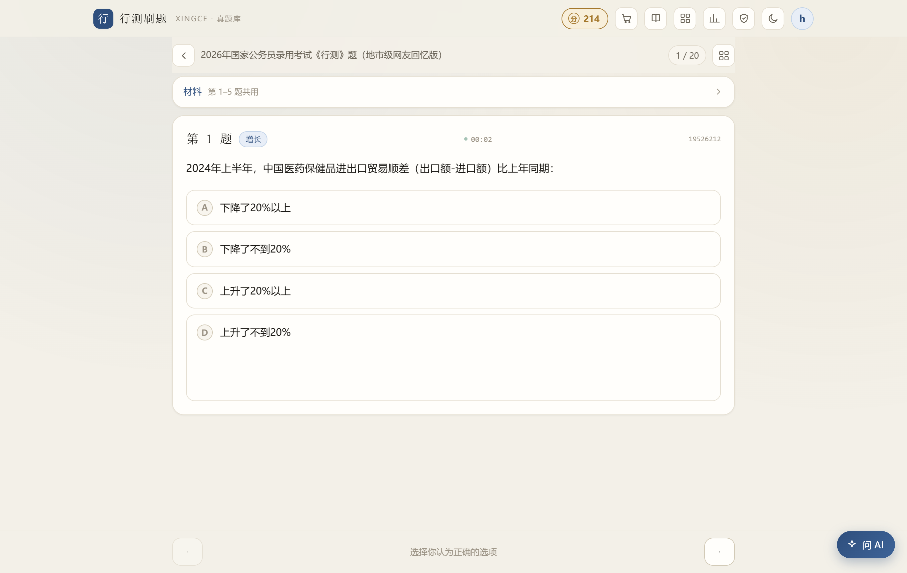
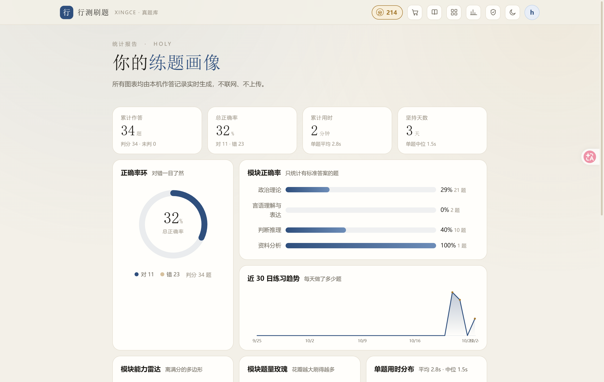
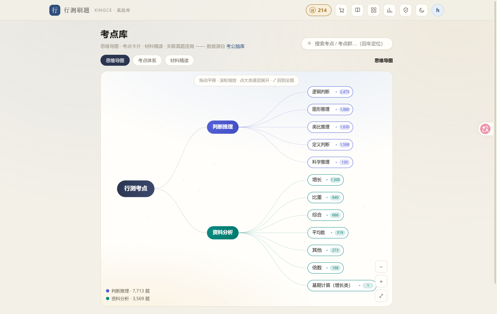
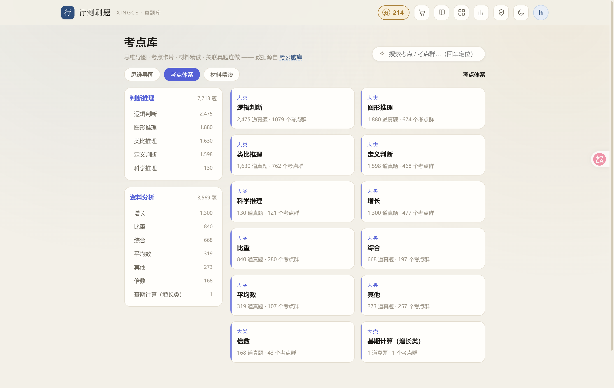
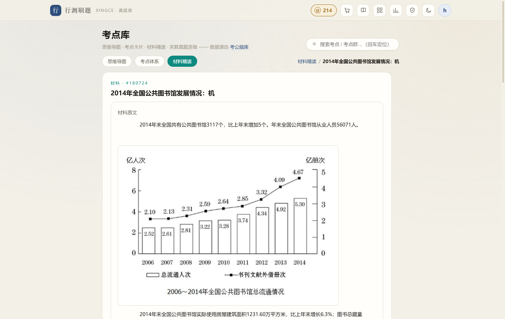
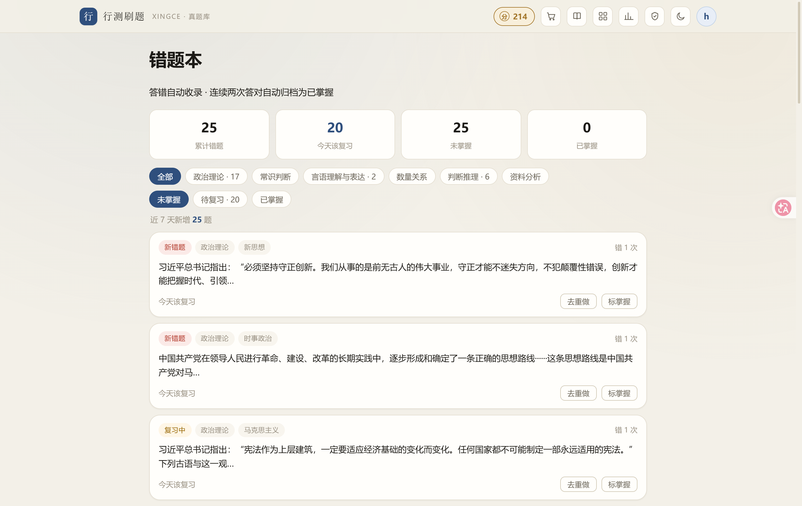
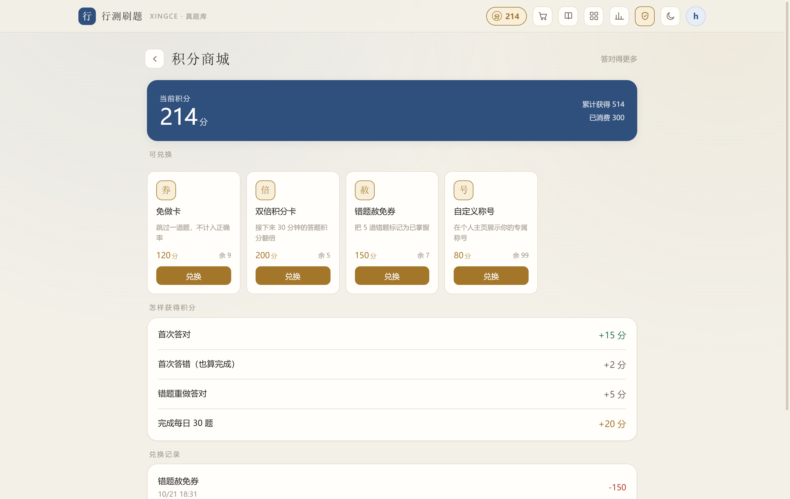
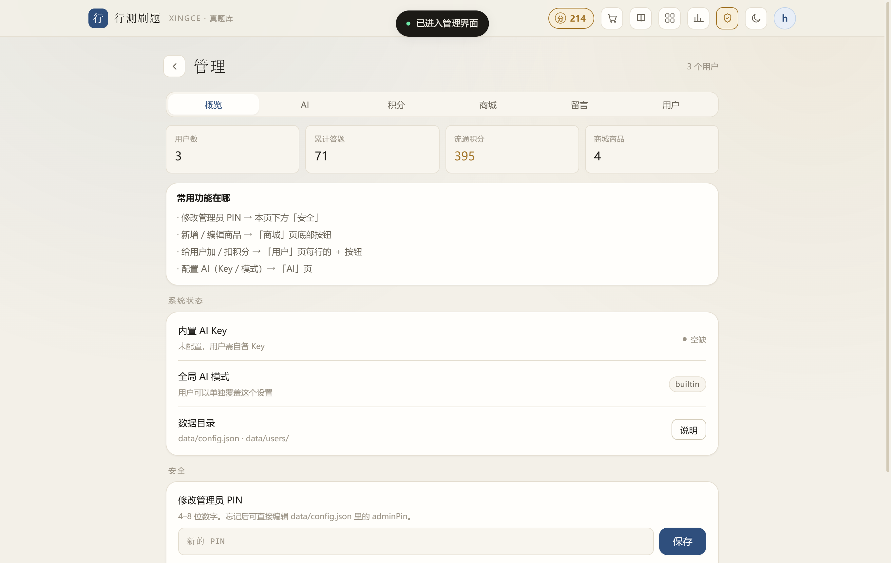

<div align="center">

# 行测刷题 · XINGCE

**「刷一道，进一步。」**

本地优先的公务员行测刷题网站 —— 零依赖 Node 服务 + 原生 JS 前端，**双击即用、全部数据存本机、断网可刷**。

    



</div>

---

## ✨ 它是什么

一套完整的行测备考工作台，把 **题库、练习、错题、统计、考点图谱** 装进一个本地网页：

- 📚 **58,890 道真题**：2016–2026 国考 + 各省省考，按 6 大模块切卷（政治理论 / 常识 / 言语 / 数量 / 判断 / 资料），图片全部本地化
- 🧠 **考点知识图谱**：来自开源「考公脑库」的 11,375 个微考点笔记 + 717 篇资料分析材料精读，考点一键关联真题连做
- 📊 **练习画像**：正确率环、模块分布、30 日趋势、能力雷达……所有图表由本机答题记录实时生成
- 🔒 **隐私优先**：进度、错题、留言、积分全部存本机 JSON 文件，不联网、不上传

## 📸 页面导览

### 🖊️ 刷题 · 先作答，再看答案

点选项立即判分，展示官方解析；资料分析材料常驻可折叠；键盘 ←/→ 翻题、数字键选择；逐题计时计入统计；右下角「问 AI」随时提问（换题自动清空记忆，防剧透）。



### 📊 统计 · 你的练习画像

Bento 数据面板：累计作答、正确率环、模块正确率、近 30 日趋势、模块能力雷达、题量玫瑰、单题用时分布，全部动效呈现。



### 🗺️ 考点库 · 思维导图 + 卡片 + 材料精读（三合一）

- **思维导图**：行测考点 → 大类 → 考点群 → 微考点逐层展开，可拖拽平移、滚轮缩放、弹簧动效，搜索考点回车即定位
- **考点体系**：11,375 个微考点的「核心立场」笔记卡片，逐层面包屑回跳，深链直达任意层级
- **材料精读**：717 篇资料分析材料拆解（统计口径 / 单位换算 / 阅读陷阱），材料原文真实渲染、图表可读，每篇附关联真题
- **考点连做**：任意考点的关联真题一键入队，做题页顶部浮条按考点顺序连刷，不用再按卷子顺序翻

| 思维导图 | 考点体系 | 材料精读 |
|---|---|---|
|  |  |  |

### 📕 错题本 · 间隔重复

答错自动收录（含题目快照，题库更新后仍可离线复原）；连续两次答对自动归档「已掌握」；下次复习日期按 1→3→7→15→30 天递进；可写笔记、打错误标签（粗心 / 不会 / 时间不够），一键跳回原题重做。



### 🪙 积分商城 · 让坚持看得见



做题赚积分，攒够了给自己「发奖品」：

- **赚分规则**（管理员可调）：首次答对、首次答错也有鼓励分、首解额外奖励、错题重做改对、每日目标达标奖励
- **防刷分**：同一道题重复作答不再计分；错题只有第一次改对时给分
- **兑换**：商品卡片显示价格与全局库存，积分不足显示「差 N 分」，兑完显示「已兑完」；兑换前二次确认，成功后写入「兑换记录」并扣减库存
- 商品与价格由管理员在「管理 → 商城」维护，兑换只在本机记账

### 🛡️ 管理员后台 · 一站式运维



「我的 → 管理员身份」输入 PIN 解锁后访问 `#/admin`（默认 PIN `8888`，可修改），六个标签页：概览 / AI / 积分 / 商城 / 留言 / 用户：

- **总览**：内置 AI 配置状态（Key 只显示掩码）、全局 AI 模式、数据目录位置、修改/退出管理员身份
- **AI**：配置内置 AI 接口地址与 Key（OpenAI 兼容）、切换全局模式（内置 Key / 用户自备 / 关闭）、预设引导提问；用户可在设置里单独覆盖
- **积分**：六项积分规则逐项可调（首答对 / 首答错 / 首解奖励 / 错题改对 / 每日目标题数 / 每日目标奖励），修改只影响之后的答题、不追溯历史
- **商城**：商品增删改、上下架、价格与全局库存管理
- **用户**：查看全部用户，支持「进入」（当前浏览器切换身份）、调整积分、删除用户，以及**账号合并**——把同一个人因昵称多打了空格产生的重复账号的进度/错题/积分合并成一份
- **留言**：全站留言管理，可删除任何留言

### 还有这些

- 💬 **留言墙**：多用户留言 + 图片（自动压缩），作者可删自己的留言，管理员可管理全部
- 🔄 **跨设备同步**：换手机/电脑用「同步码」登录即恢复全部记录，同一身份多端自动静默同步
- 🤖 **AI 解题助手**：多轮流式对话只围绕当前题目；内置 Key / 自备 Key（OpenAI 兼容）/ 关闭 三种模式，Key 只存本机永不下发明文
- 🌙 **纸墨主题**：浅色 / 深色 / 跟随系统；手机在同一局域网直接访问（服务监听 `0.0.0.0`）

## 🚀 快速开始

> 只需安装 [Node.js](https://nodejs.org/)（LTS 版即可），无需 `npm install`。

```bash
git clone https://github.com/HOLY0305/AATpractice.git
cd AATpractice
```

**Windows**：双击 **`重建数据.bat`**（首次自动从上游拉取题库约 260MB 并构建 JSON），完成后双击 **`启动网站.bat`**，浏览器自动打开 `http://localhost:3456`。

**手动执行**（任意平台）：

```bash
node tools/fetch-bank.cjs          # ① 拉取上游题库 + 考点文件树（需要网络，仅首次）
node tools/build.mjs               # ② Markdown 题库 → app/data/papers/*.json
node tools/build-knowledge.cjs     # ③ 考点库 → knowledge.json / materials.json / qidmap.json
node server.js                     # ④ 启动服务 → http://localhost:3456
```

> 想启用 AI 助手：复制 `data/config.example.json` 为 `data/config.json`，填入 OpenAI 兼容接口地址与 Key；不配置则以演示模式运行，其余功能不受影响。

## 🔄 更新题库

```bash
node tools/fetch-bank.cjs && node tools/build.mjs
# 或直接重新运行 重建数据.bat
```

## 📁 目录结构

```
AATpractice/
├── 启动网站.bat          # 双击启动（localhost:3456）
├── 重建数据.bat          # 首次使用/题库更新：拉取上游 → 构建 JSON
├── server.js             # 本地服务（零依赖 Node：静态资源 + 数据 API + 管理接口）
├── tools/
│   ├── fetch-bank.cjs    # 拉取上游题库（xingcezhenti）+ 考点文件树
│   ├── build.mjs         # Markdown 题库 → papers/*.json 构建器
│   ├── build-knowledge.cjs # 文件树 → knowledge/materials/qidmap
│   └── verify-*.cjs      # 端到端验收脚本（puppeteer-core + Edge）
├── app/                  # 前端（原生 JS，无构建步骤）
│   ├── index.html
│   ├── style.css         # 设计系统：token / 组件 / 深色模式
│   ├── views.css         # 页面级布局
│   ├── app.js            # 路由 + 顶部导航
│   ├── js/               # core（工具）store（状态）views（页面）
│   └── data/             # 构建产物（不入库，重建数据.bat 生成）
├── docs/screenshots/     # README 配图
└── data/                 # 本机运行数据（不入库）
    ├── config.json       # 全局配置（含 AI Key 与 PIN，敏感；模板见 config.example.json）
    ├── users/            # 每用户一份 JSON
    └── xingcezhenti/     # 上游题库（fetch-bank.cjs 下载）
```

## 🔐 隐私与安全（脱敏说明）

本仓库**不包含**以下内容（已全部加入 `.gitignore`）：

- `data/config.json` —— 管理员 PIN 与 AI API Key（敏感）。首次使用复制 `data/config.example.json` 为 `config.json`；不复制也能启动，服务会以演示模式兜底
- `data/users/`、`data/messages*` —— 用户答题记录、留言与上传图片（个人信息）
- `data/xingcezhenti/`、`data/main.zip` —— 上游题库（体积大且版权属上游，由脚本按需拉取）
- `app/data/` —— 构建产物，可由 `重建数据.bat` 一键重建
- `tools/shots*/`、`tools/uds*/` —— 验收截图与浏览器临时目录（可能含界面上的用户名）

服务监听 `0.0.0.0`（方便手机在同一局域网访问），请勿将端口暴露到公网；管理员 PIN 仅防误触，不构成安全边界。

## 📖 数据来源与版权声明

本项目的**题目内容与考点笔记均来自以下开源仓库**，本仓库只包含网站代码与构建脚本，不分发题目数据：

| 仓库 | 用途 | 授权 |
|---|---|---|
| [ERRRC/xingcezhenti](https://github.com/ERRRC/xingcezhenti) | 题库源数据（2016–2026 行测真题 Markdown，经 `tools/build.mjs` 转为 JSON） | 真题题干/选项/解析/配图著作权归原出题机构及原题库平台所有 |
| [ERRRC/kaogongzhentizhengliu](https://github.com/ERRRC/kaogongzhentizhengliu) | 考点知识图谱（文件树 → 导图/卡片/材料精读）；笔记正文运行时从 jsDelivr CDN 懒加载 | 上游自行创作的标注与分类部分采用 [CC BY-NC 4.0](https://creativecommons.org/licenses/by-nc/4.0/legalcode.zh-hans)（非商业性使用） |

**免责声明**：真题题干、选项、材料原文与配图的著作权归原出题机构及原题库平台所有。本项目仅用于个人学习交流，不得用于商业用途。如权利人认为内容侵权，请提 Issue，核实后立即处理。

## License

- 本仓库的**网站代码与构建脚本**采用 [MIT](LICENSE)
- 经由本网站呈现的**题目与考点笔记内容**，授权与著作权归属遵循上表所述上游仓库的声明（真题内容归原机构，标注部分 CC BY-NC 4.0，非商业使用）
